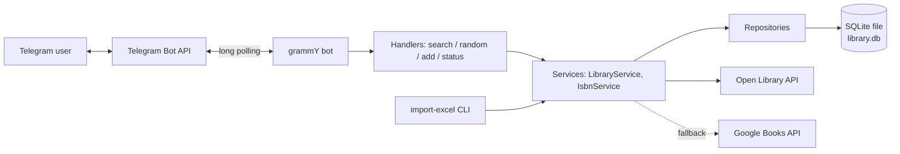
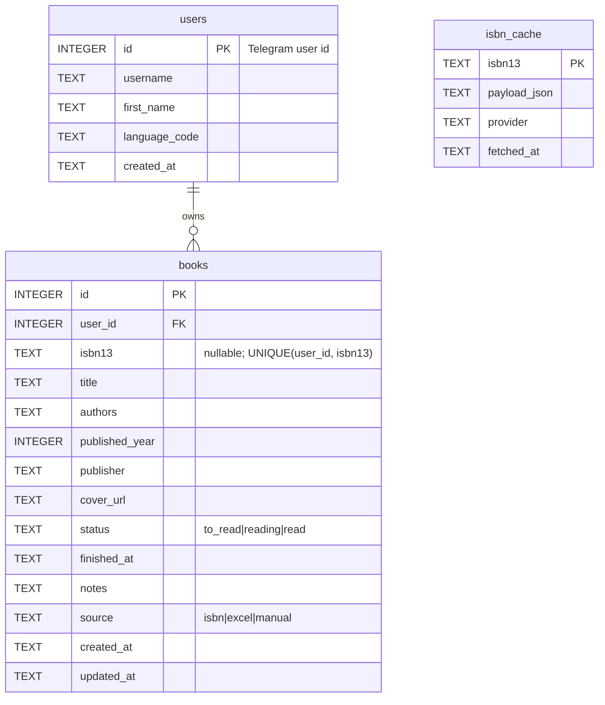
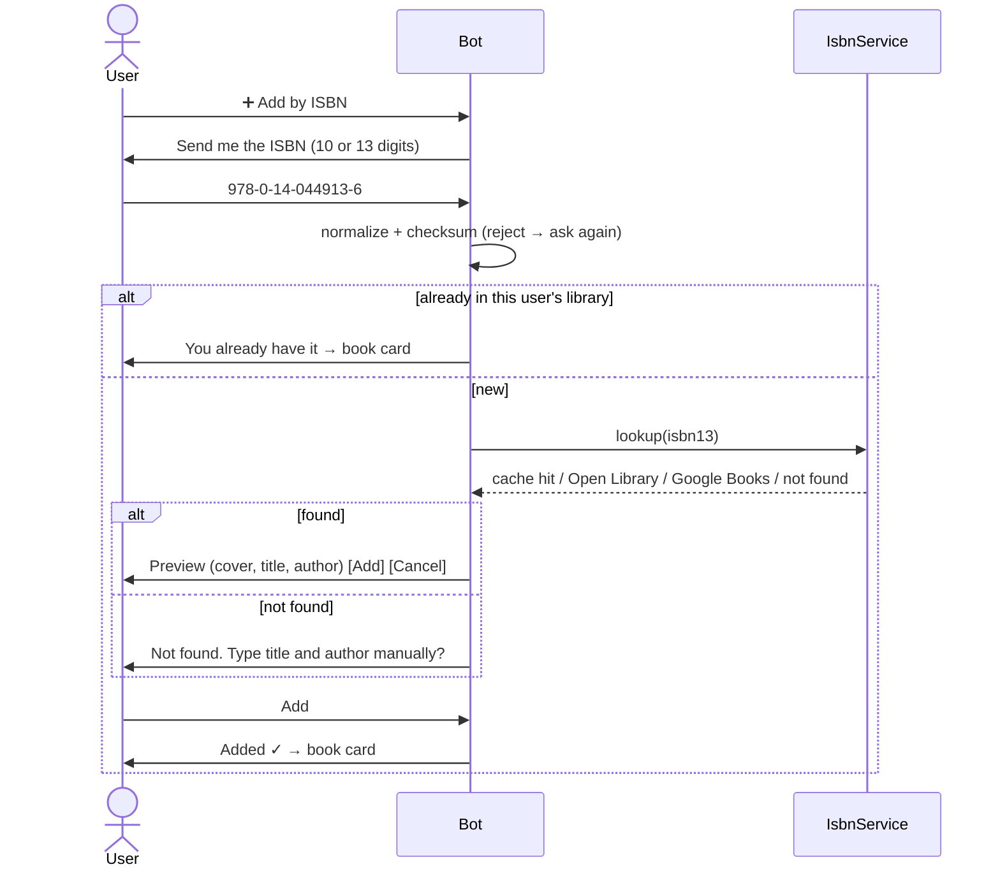

---
planStatus:
  planId: plan-telegram-book-library-bot
  title: Telegram Book Library Bot
  status: draft
  planType: feature
  priority: high
  owner: nazarkon
  stakeholders: []
  tags:
    - telegram-bot
    - typescript
    - sqlite
    - excel-import
  created: "2026-11-14"
  updated: "2026-11-14T09:00:00.000Z"
  progress: 0
---
# Telegram Book Library Bot

## Goal

A Telegram bot where each user keeps their own book library. Users can:

1. **Search** their library by title (and author).
2. **Set reading status**: To-read, Reading, or Read. Read books get a finish date.
3. **Get a random book**: one button picks a random unread book.
4. **Add a book by ISBN**: the user types an ISBN and the bot fills in the details from Open Library, falling back to Google Books.
5. **Have a separate library**: every query is scoped to the user's Telegram ID.

Plus a one-off **import of the existing Excel library** into SQLite.

## Decisions

| Area | Choice | Why |
| --- | --- | --- |
| Language | **TypeScript (Node 24)** | Your choice. Node 24.11 is already installed. |
| Bot framework | **grammY** + `@grammyjs/conversations` + `@grammyjs/ratelimiter` | Well-typed, actively maintained. Conversations handle multi-step flows like adding a book. |
| Database | **SQLite** via `better-sqlite3` | One file, synchronous and fast, with good FTS5 support. More proven than the built-in `node:sqlite`. |
| Migrations | Plain `.sql` files plus a small runner that uses the `user_version` pragma | No ORM needed for 3–4 tables. |
| ISBN metadata | Open Library first, then Google Books as fallback. Results are cached in the DB. | Neither needs an API key. |
| Status model | `to_read` / `reading` / `read` + `finished_at` | Your choice. |
| Access | **Open**: anyone gets a library on `/start` | Your choice. This makes rate limiting and per-user isolation required. |
| Hosting | **VPS + Docker**, long polling | Long polling needs no domain or TLS. Webhooks are optional later. |
| Excel parsing | `exceljs` | Reads `.xlsx` and handles dates and types better than `xlsx` (SheetJS on npm is outdated). |
| Validation / config | `zod` for env and API responses | Fails fast on a bad config or an unexpected API response. |
| Tests | `vitest` | Fast and works well with TypeScript. |

## Architecture



### Project layout

```
src/
  index.ts              # bootstrap: config, db, bot.start()
  config.ts             # zod-validated env (BOT_TOKEN, DB_PATH, LOG_LEVEL)
  bot/
    bot.ts              # Bot instance, middleware (session, ratelimit, user upsert, error handler)
    keyboards.ts        # main reply keyboard + inline keyboards
    handlers/
      start.ts          # /start, /help
      search.ts         # 🔍 Search + free-text search
      random.ts         # 🎲 Random book
      addBook.ts        # ➕ Add by ISBN (conversation)
      bookCard.ts       # render book + status callbacks
      stats.ts          # /stats (optional, cheap)
  db/
    index.ts            # open DB, pragmas (WAL, foreign_keys), run migrations
    migrations/001_init.sql
    repositories/{users,books,isbnCache}.ts
  services/
    library.ts          # search, random, setStatus, addBook, delete
    isbn/
      normalize.ts      # strip, validate checksum, ISBN-10 → ISBN-13
      openLibrary.ts
      googleBooks.ts
      index.ts          # lookup with cache + fallback
  import/
    excel.ts            # CLI: parse xlsx → upsert books for a user
test/
Dockerfile, docker-compose.yml, .env.example
```

## Data model



- `books.user_id` appears in **every** query. That is how libraries stay separate, and it gets a dedicated test.
- `books_fts` is an FTS5 virtual table on `title` and `authors`, kept in sync by triggers. It uses the `unicode61 remove_diacritics 2` tokenizer. **Important:** SQLite's `LIKE` only ignores case for ASCII letters, so plain `LIKE` would miss Cyrillic titles typed in a different case. FTS5 handles them correctly. Prefix search (`"гарр"*`) supports search-as-you-type.
- Indexes: `(user_id, status)` for random and filtering, `(user_id, isbn13)` unique.
- Books imported from Excel without an ISBN are allowed (`isbn13` is NULL). SQLite allows multiple NULLs under a UNIQUE constraint.

## UX / bot flows

**Main reply keyboard** (always visible): `🔍 Search` · `🎲 Random` · `➕ Add by ISBN` · `📚 My library`

**Book card** (inline buttons under each book):
`📖 Reading` · `✅ Read` · `🕮 To-read` · `🗑 Delete` (asks for confirmation). Read books show the finish date.



- **Search**: after `🔍 Search`, or any plain text outside a conversation, the bot runs an FTS search. It shows up to 10 results as inline buttons and paginates beyond that. Tapping a result opens its book card.
- **Random**: picks with `ORDER BY random() LIMIT 1` over books with `status IN ('to_read')`. That query is fine for libraries of thousands of books. The card adds a `🎲 Another one` button. If every book is read, the bot says so and offers to pick from all books.
- **My library**: counts by status and a paginated list filtered by status.
- Callback data stays under Telegram's 64-byte limit, using compact strings like `b:123:st:read` and `pg:search:2`. Every callback checks that the book belongs to `ctx.from.id`.

## Excel import

The file isn't available yet. You'll add it later. The import will be built as a configurable CLI:

```
npm run import -- --file ./data/library.xlsx --user <telegram_id> [--sheet Name] [--dry-run]
```

- Column mapping goes in a small config object, filled in once the real headers are known. Header matching ignores case and accepts aliases such as `Назва`/`Title`/`Book` → title.
- Each row is normalized: trimmed, the ISBN cleaned and validated, and status mapped from values like "yes/так/read/+" to `read`.
- Upsert key: `isbn13` if present, otherwise `(lower(title), lower(authors))`. Running the import twice must not create duplicates.
- Optional `--enrich`: for rows with an ISBN but no author or year, fetch details from the ISBN service with throttling, at about 1 request per second.
- At the end it prints a report: rows inserted, updated, skipped, plus any invalid ISBNs with their row numbers.
- Stretch goal: in-bot `/import`, where a user sends an `.xlsx` and it is imported into their own library. This fits well with the open-access model.

## Security & robustness (open bot)

- Per-user rate limiting (`@grammyjs/ratelimiter`). Outbound ISBN lookups have their own limit, so one user can't get us throttled by Open Library or Google.
- Every repository method takes `userId` as a required parameter. No method can read books without it.
- Inputs: limit search text to about 100 characters, escape FTS query syntax, and validate the ISBN checksum before any network call.
- External APIs: 5-second timeout, zod-validated responses, and failures degrade to manual entry.
- The bot token is stored only in `.env`, never committed. `.env.example` is provided.
- Global error handler (`bot.catch`) plus structured logs (`pino`).
- SQLite pragmas: `journal_mode=WAL`, `foreign_keys=ON`, `busy_timeout=5000`.

## Deployment (VPS)

- Multi-stage `Dockerfile` (node:24-slim; `better-sqlite3` needs build tools only in the build stage).
- `docker-compose.yml` with a named volume for `/data/library.db` and `restart: unless-stopped`.
- **Backups**: a daily `sqlite3 library.db ".backup ..."` cron job to off-box storage, or Litestream to S3/B2. This is the only copy of users' data, so it matters.
- Graceful shutdown: on SIGTERM, `bot.stop()` runs and the DB is closed.

## Phases

### Phase 1: Skeleton & DB (foundation)
- [ ] `npm init`, TypeScript, tsx for development, eslint/prettier, vitest
- [ ] `config.ts` with zod; `.env.example`
- [ ] DB bootstrap, migration runner, `001_init.sql` (users, books, books_fts + triggers, isbn_cache)
- [ ] Repositories with `userId`-scoped methods
- [ ] `/start` that saves the user and shows the main keyboard
- **Done when:** the bot answers `/start` and a row appears in `users`.

### Phase 2: ISBN service & add-by-ISBN
- [ ] `normalize.ts`: strip hyphens and spaces, ISBN-10 and ISBN-13 checksums, convert 10 → 13 (unit-tested)
- [ ] Open Library client (`/isbn/{isbn}.json` plus a follow-up request to `/authors/...` for names, or `/api/books?bibkeys=ISBN:...&jscmd=data&format=json` in one call)
- [ ] Google Books fallback (`/books/v1/volumes?q=isbn:...`)
- [ ] Cache in `isbn_cache`
- [ ] Add conversation: preview, confirm, save; duplicate detection; manual fallback when the ISBN isn't found
- **Done when:** entering a real ISBN adds a correct book, and an invalid ISBN is rejected without a network call.

### Phase 3: Search, book card, status, random
- [ ] FTS search with prefix matching and pagination
- [ ] Book card renderer (with cover photo when available) and status/delete callbacks with ownership check
- [ ] `🎲 Random` that prefers to-read books, with an `Another one` button
- [ ] `📚 My library`: counts and lists filtered by status
- **Done when:** all 5 core features work in Telegram, and user B cannot see or modify user A's books (automated test).

### Phase 4: Excel import
- [ ] Inspect the real file and fill in the column mapping
- [ ] CLI with `--dry-run`, idempotent upsert, report output
- [ ] Optional `--enrich`
- **Done when:** your full library is imported, the counts match the spreadsheet, and a second run changes nothing.

### Phase 5: Hardening & deploy
- [ ] Rate limiting, error handler, logging, graceful shutdown
- [ ] Dockerfile + compose + backup cron, deployed on the VPS
- [ ] Short README: setup, env, import, deploy
- **Done when:** the bot runs on the VPS, survives a restart with data intact, and a backup restore has been tested.

### Later / nice-to-have
- In-bot `.xlsx` import (`/import`) for other users
- `/export` back to Excel or CSV
- Ratings and notes per book; tags or shelves
- Barcode photo → ISBN (decode on the server with `zxing`)
- Ukrainian/English UI localization (`@grammyjs/i18n`)
- Inline mode (`@bot query`) to share a book in any chat

## Testing

- Unit: ISBN normalization and checksums, Excel row mapping, FTS query escaping.
- Integration: repositories against an in-memory SQLite DB (`:memory:` with migrations applied), including a **cross-user isolation** test.
- API clients: recorded fixtures (no live network in CI).
- Manual: a test bot from @BotFather (separate token from production).

## Open questions

1. **Excel file**: columns, sheet layout, and how "read" is currently recorded. This blocks Phase 4 only.
2. **Bot UI language**: English, Ukrainian, or both?
3. **Which VPS** (Hetzner, DigitalOcean, etc.)? This only affects the deploy notes, not the code.
4. **Delete vs. archive**: should deleted books disappear permanently or be soft-deleted?
