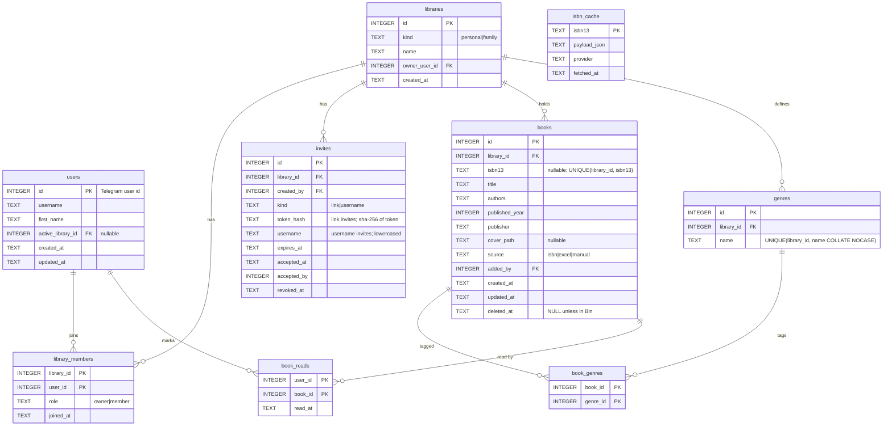
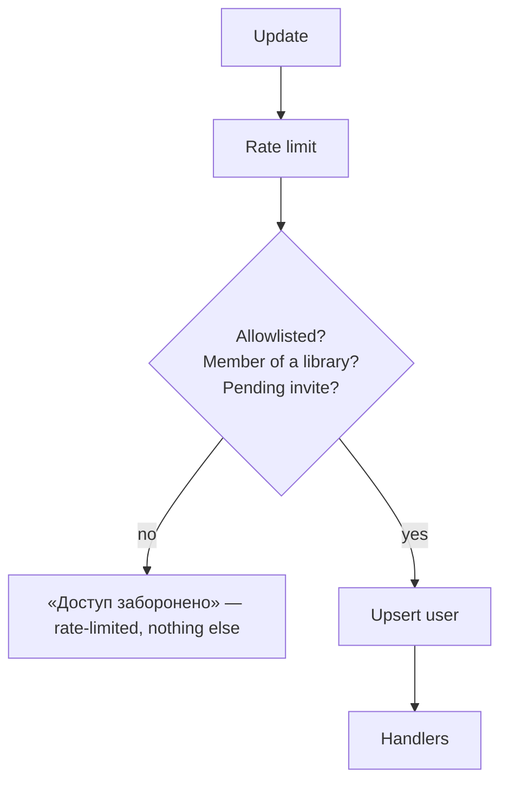
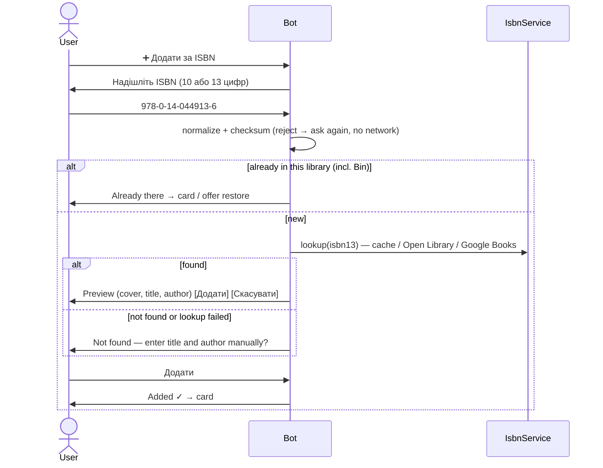

---
planStatus:
  planId: plan-telegram-book-library-bot
  title: Telegram Book Library Bot
  status: draft
  planType: feature
  priority: high
  owner: nazarkon
  stakeholders: []
  tags:
    - telegram-bot
    - typescript
    - sqlite
    - excel-import
  created: "2026-11-14"
  updated: "2026-11-15T09:00:00.000Z"
  progress: 0
---
# Telegram Book Library Bot

## Goal

A private Telegram bot for a household's books. Books live in **libraries**: each
user has one personal library and can share up to three family libraries with up
to five people each. Inside a library, members can:

1. **Search** books by title and author.
2. **Mark books as read**: «Прочитано» / «Не прочитано», tracked **per user**, so
   one member's status never changes another's.
3. **Get a random book**: one button picks a random book the current user hasn't read.
4. **Add a book by ISBN**: the bot fills in the details (and cover) from Open
   Library, falling back to Google Books, with manual entry if both fail.
5. **Delete to the 🗑 Bin** and restore from it.

Plus a one-off **import of the existing Excel library** (`nimbalyst-local/Library.xlsx`).

The bot is not public. Only allowlisted users, library members and people with a
pending invite can use it.

## Resolved decisions

| Area | Choice | Why |
| --- | --- | --- |
| Migrations | Plain `.sql` files + a small runner using the `user_version` pragma | No ORM needed. |
| Access | **Allowlist + invites**: `ALLOWED_USER_IDS`, library members, or a pending unexpired invite | A private household bot, not an open service. |
| Library model | Books, genres, reads and the Bin belong to a **library**. 1 personal + up to 3 family libraries per user. | Lets a family share one catalogue while keeping personal shelves separate. |
| Family library size | Members + pending invites **≤ 5**, enforced in code and by a DB trigger | Keeps it a household feature. |
| Who creates family libraries | Allowlisted users only. Invited members can join and create their own personal library. | The allowlist stays the root of trust. |
| Family library roles | Only the **owner** (creator) can invite, revoke invites, remove members, rename or delete the library. Members can add, edit, read-mark, bin and restore books, and leave. | Owner decision. |
| Owner leaving | Ownership passes to the remaining member who joined earliest. If nobody is left, the library and its books are deleted. | Owner decision (last-member case is the plan's default). |
| Read status | Per user, binary: a `book_reads (user_id, book_id)` row means «Прочитано» | Simple, and works for shared libraries. Replaces the old to-read/reading/read model. |
| Delete | **Soft delete** to a 🗑 Bin (`deleted_at`), excluded everywhere through one shared repository helper. No auto-purge. Any member can restore. «Видалити назавжди» is final and can't be undone. | Owner decision. |
| Genres | **Several per book** (`book_genres` join table), per library, any member can create them | The spreadsheet already lists several genres per book. |
| Invites | Link tokens (≥ 16 random bytes, single-use, **48 h expiry**, constant-time compare) and username invites (match the current username, re-checked on accept, same 48 h expiry) | Safe to paste into a chat; usernames can change hands. |
| Covers | Downloaded only from Open Library / Google Books hosts, 5 s timeout, ≤ 5 MB, must decode as a real image, resized with `sharp`, stored on the volume; placeholder on any failure | No hotlinking, no surprises from arbitrary URLs. |
| Search | FTS5 (`unicode61 remove_diacritics 2`), input ≤ ~100 chars, query syntax escaped | `LIKE` is case-insensitive only for ASCII, not Cyrillic. |
| UI language | **Ukrainian**; all strings in `src/i18n/uk.ts` | The household's language. |
| Hosting | **Fly.io**, one machine, volume at `/data`, long polling, `fly scale count 1` | No domain/TLS needed; SQLite needs a single writer. |
| Backups | **None** beyond what Fly gives by default | Pet project; owner decision. |
| Secrets | `.env` locally, **Fly secrets** in production; `.env.example` committed | Nothing secret in git or `fly.toml`. |
| Logs / tests | `pino` / `vitest` | Structured logs; fast TS-native tests. |
| Language | **TypeScript (Node 24)** | Node 24.11 is already installed. |
| Bot framework | **grammY** + `@grammyjs/conversations` + `@grammyjs/ratelimiter` | Well-typed and maintained. Conversations handle multi-step flows like adding a book. |
| Database | **SQLite** via `better-sqlite3` | One file, synchronous, good FTS5 support. |
| ISBN metadata | Open Library first, Google Books fallback, cached in `isbn_cache`, separate outbound rate limit | Neither needs an API key. |
| Excel parsing | `exceljs` | Handles dates and types well. |
| Validation / config | `zod` for env and API responses | Fails fast on bad config or unexpected API data. |

## Architecture

```mermaid
flowchart LR
  U[Telegram user] <--> TG[Telegram Bot API]
  TG <-- long polling --> BOT[grammY bot]
  BOT --> MW[Middleware: ratelimit → access check → user upsert]
  MW --> H[Handlers: libraries / invites / search / random / add / card / bin]
  H --> SVC[Services: LibraryService, InviteService, IsbnService, CoverService]
  SVC --> REPO[Repositories (libraryId-scoped)]
  REPO --> DB[(SQLite /data/library.db)]
  SVC --> FS[(/data/covers)]
  SVC --> OL[Open Library]
  SVC -. fallback .-> GB[Google Books]
  CLI[import-excel CLI] --> SVC
```

### Project layout

```
src/
  index.ts              # bootstrap: config, db, bot.start(), SIGINT/SIGTERM shutdown
  config.ts             # zod env: BOT_TOKEN, ALLOWED_USER_IDS, DB_PATH, COVERS_DIR, LOG_LEVEL
  logger.ts             # pino
  i18n/uk.ts            # every user-facing string
  bot/
    bot.ts              # Bot instance, middleware chain, bot.catch
    middleware/
      access.ts         # allowlist / member / pending-invite gate
      activeLibrary.ts  # resolves the user's current library + assertMember
    keyboards.ts        # main reply keyboard + inline keyboards
    callbackData.ts     # compact encode/decode, asserts < 64 bytes
    handlers/
      start.ts          # /start, /help, invite deep links
      libraries.ts      # list / switch / create family / members / leave
      invites.ts        # create link or username invite, accept, revoke
      search.ts         # 🔍 search + free-text search
      random.ts         # 🎲 random unread book
      addBook.ts        # ➕ add by ISBN (conversation) + manual entry
      bookCard.ts       # card render + read toggle / genre / delete callbacks
      bin.ts            # 🗑 list, restore, delete permanently
  db/
    index.ts            # open DB, pragmas, run migrations
    migrations/001_init.sql
    repositories/
      scope.ts          # the shared "not in Bin" helper
      users.ts libraries.ts invites.ts books.ts genres.ts reads.ts isbnCache.ts
  services/
    library.ts          # search, random, add, delete/restore, reads
    invites.ts          # token generation/hashing, accept, limits
    covers.ts           # host allowlist, size/timeout, sharp resize, placeholder
    isbn/
      normalize.ts      # strip, checksums, ISBN-10 → ISBN-13
      openLibrary.ts
      googleBooks.ts
      index.ts          # cache + fallback + outbound rate limit
  import/
    excel.ts            # CLI: parse xlsx → upsert into a library
test/
Dockerfile, .dockerignore, fly.toml, .env.example
```

## Data model



- Every repository method on books, genres, reads or the Bin takes `libraryId`,
  and every query filters on `library_id`. Bin exclusion goes through
  `db/repositories/scope.ts`; only the Bin's own queries bypass it.
- `isbn_cache` is global: it holds public metadata, not library data.
- `book_genres` links a book to genres **of the same library** (checked in code
  and by a trigger), so a genre can never leak across libraries.
- `books_fts`: FTS5 on `title` and `authors`, kept in sync by triggers, tokenizer
  `unicode61 remove_diacritics 2`, prefix search (`"гарр"*`).
- Indexes: `(library_id, deleted_at)`, `(library_id, isbn13)` unique,
  `book_reads(book_id)`, `invites(token_hash)`.
- A unique partial index enforces one personal library per owner. A trigger on
  `library_members` and `invites` rejects inserts that would push a family library
  above 5 members + pending invites. The 3-family-library limit is checked in code.
- A binned book still holds its `isbn13`. Adding the same ISBN again finds it and
  offers to restore it instead of creating a duplicate.
- Books without an ISBN are allowed (`isbn13` NULL; SQLite allows multiple NULLs
  under UNIQUE).

## Access & libraries



- `/start` for an allowed user with no libraries creates their personal library
  and sets it as active.
- The user picks the **active library** from `📚 Бібліотеки`; it is stored in
  `users.active_library_id`, so it survives restarts. Every handler re-checks
  `assertMember(ctx.from.id, libraryId)`; a stale active library (after leaving)
  falls back to the personal library.
- Invite links are `t.me/<bot>?start=inv_<token>` with a base64url token of ≥ 16
  random bytes. Only the SHA-256 hash is stored, compared with `timingSafeEqual`.
  Accepting is one transaction: re-check expiry, single use, the 5-person limit
  and the user's 3-family limit, then add the membership and mark the invite used.
- Username invites store the lowercased username. On accept, the user's
  **current** `ctx.from.username` must still match.
- Invites expire after **48 hours**. Only the library owner can create or revoke
  them, remove members, rename or delete the library.
- Leaving a library deletes the membership and that user's `book_reads` for the
  library's books, in one transaction. If the owner leaves, ownership passes to the
  remaining member who joined earliest; if nobody is left, the library is deleted.
  A personal library can't be left.

## UX / bot flows

**Main reply keyboard:** `🔍 Пошук` · `🎲 Випадкова` · `➕ Додати за ISBN` ·
`📚 Бібліотеки` · `🗑 Кошик` (exact wording lives in `uk.ts`). The current
library's name is shown in replies so it's clear where a book goes.

**Book card** (inline): `✅ Прочитано` / `↩️ Не прочитано` (for the current
user) · `🏷 Жанр` · `🗑 Видалити` (asks for confirmation, moves to the Bin).
Family libraries also show how many members have read it.



- **Search**: after `🔍 Пошук`, or any plain text outside a conversation. FTS in
  the active library, 10 results per page as inline buttons.
- **Random**: `ORDER BY random() LIMIT 1` over non-binned books in the active
  library with no `book_reads` row for the current user. `🎲 Ще одну` button.
  If the user has read everything, say so and offer a pick from all books.
- **Library overview**: totals, read / unread for the current user, filter by genre.
- **Bin**: paginated list with `♻️ Відновити` and `❌ Видалити назавжди`
  (confirmed, final). Any member can restore. Nothing is purged automatically.
- **Callbacks**: compact strings like `b:123:r`, `b:123:del`, `pg:s:2`, kept
  < 64 bytes (asserted in `callbackData.ts`). A `bookId` from callback data is
  looked up, its `library_id` checked with `assertMember`, never trusted alone.

## Excel import

`nimbalyst-local/Library.xlsx` is now available locally. It contains prices and
purchase info, so it is **never** committed, force-added or copied into the Docker
image.

What the file holds (checked 2026-11-15, headers only):

| Sheet | Rows | Notes |
| --- | --- | --- |
| Книги | 458 | Назва, Автор, Видавець, Рік вид., Жанр (comma-separated), Цикл, Частина, Хто збирав, Мова… |
| Манга | 101 | Author column is «Манґака (Автор/Худ)»; Тип, Вид |
| КоміксиБандесіне | 503 | Authors split into «Сценарій» / «Малюнок»; Жанр comma-separated |
| Толкін | 505 | The only sheet with an **ISBN** column; different layout |
| Іноземні | 0 | Empty |
| Книги Люда | 286 | Same layout as «Книги» |
| Манга Люда | 100 | Same layout as «Манга» |

- Import only **Книги, Манга, КоміксиБандесіне, Толкін**. «Книги Люда», «Манга
  Люда» and the empty «Іноземні» are skipped (owner decision).
- The «Прочитання (статус)» column is **empty in every sheet**, so the import
  creates no `book_reads`. Users mark books read in the bot.
- Most rows have no ISBN, so the title + authors upsert key does most of the work.

```
npm run import -- --file nimbalyst-local/Library.xlsx --library <id> --sheet <name> [--dry-run] [--enrich]
```

- One column mapping per sheet layout (Книги, Манга, Комікси, Толкін), matched by
  header text, ignoring case. Comics: `authors` = Сценарій + Малюнок. Price,
  purchase place/date, condition and «Хто збирав» are **not** imported.
- Each row: trimmed, ISBN cleaned and checksum-validated, the comma-separated
  «Жанр» split into genres matched or created in the target library.
- Upsert key: `isbn13` if present, otherwise `(lower(title), lower(authors))`, all
  in one transaction. A second run changes nothing.
- `--enrich`: fill missing author/year/cover via the ISBN service, ~1 request/s.
- Final report: inserted, updated, skipped, and invalid ISBNs with row numbers.

## Security & robustness

The full checklist is in `AGENTS.md` ("Non-negotiable rules"). In short: access
middleware before every handler; `libraryId` on every scoped query and
`assertMember` in every handler; parameterized SQL only; search capped and
escaped; ISBN checksum before any network call; 5 s timeouts and zod-validated
responses for external APIs; outbound ISBN rate limit separate from the per-user
one; safe cover downloads; strong single-use invite tokens; multi-step writes in
transactions; `bot.catch` with pino; WAL + `foreign_keys` + `busy_timeout=5000`;
SIGINT and SIGTERM handled; exactly one poller.

## Deployment (Fly.io)

- Multi-stage `Dockerfile` (node:24-slim; build tools only in the build stage for
  `better-sqlite3` and `sharp`). `.dockerignore` excludes `.env`, `*.db`, `/data`,
  `nimbalyst-local/`.
- `fly.toml`: no `[http_service]` (long polling), volume mounted at `/data`,
  `DB_PATH=/data/library.db`, `COVERS_DIR=/data/covers`. No secrets.
- `fly secrets set BOT_TOKEN=… ALLOWED_USER_IDS=…`; `fly scale count 1`.
- Shutdown: on SIGINT (Fly's default) or SIGTERM, stop polling, let the current
  update finish, close the DB.
- No backups beyond Fly's defaults (pet project).

## Phases

### Phase 1: Skeleton, DB, access
- [x] `npm init`, TypeScript, tsx for development, eslint/prettier, vitest; `.gitignore` covers `.env`, `*.db`, `/data`, `nimbalyst-local/Library.xlsx`
- [x] `config.ts` (zod) and `.env.example`; `logger.ts` (pino); `i18n/uk.ts`
- [x] DB bootstrap with pragmas, migration runner, `001_init.sql` (all tables above, `books_fts` + sync triggers, personal-library unique index, family-size trigger)
- [ ] Repositories: `libraryId`-scoped methods, shared Bin-exclusion helper, `assertMember`
- [ ] Middleware: per-user rate limit, access gate with «Доступ заборонено», user upsert; `bot.catch`; SIGINT/SIGTERM shutdown
- [ ] `/start`: creates the personal library on first use and shows the main keyboard
- **Done when:** an allowlisted user gets the keyboard and a personal library row on `/start`; a stranger gets only «Доступ заборонено»; the family-size trigger and the repository isolation tests pass against `:memory:`.

### Phase 2: Family libraries & invites
- [ ] `📚 Бібліотеки`: list, switch active library, create family library (allowlisted only, ≤ 3)
- [ ] Link invites: generate, hash, expire, single use, constant-time compare; deep-link accept
- [ ] Username invites: create, accept with current-username re-check
- [ ] Members list, owner-only actions (revoke invite, remove member, rename, delete), leave library with ownership transfer (one transaction, reads removed)
- [ ] Tests: limits (5 per family, 1 personal, 3 family), expired/used/revoked tokens, username changed before accept, non-owner can't use owner actions, ownership transfer, non-member can't act on a library
- **Done when:** two test accounts can share a family library via a link and via a username invite, and every limit and token test passes.
- **Done when:** the bot answers `/start` and a row appears in `users`.

### Phase 3: ISBN service, covers & add-by-ISBN
- [ ] `normalize.ts`: strip, ISBN-10/13 checksums, 10 → 13 (unit-tested)
- [ ] Open Library client and Google Books fallback (5 s timeout, zod, recorded fixtures)
- [ ] `isbn_cache` and the outbound lookup rate limit
- [ ] `covers.ts`: host allowlist, ≤ 5 MB, real-image check, `sharp` resize, placeholder fallback
- [ ] Add conversation: preview, confirm, save to the active library; duplicate and in-Bin detection; manual entry fallback
- **Done when:** a real ISBN adds a correct book with a cover, an invalid ISBN is rejected without a network call, and a failing provider or cover falls back cleanly.

### Phase 4: Search, card, reads, random, Bin
- [ ] FTS search with prefix matching, escaping, pagination
- [ ] Book card (cover photo when present) with per-user read toggle, genres (several), delete-to-Bin
- [ ] `🎲 Випадкова` over the current user's unread books, `Ще одну` button
- [ ] Library overview with read/unread counts and genre filter
- [ ] `🗑 Кошик`: list, restore, delete permanently
- [ ] Isolation tests: non-member can't see, find or change another library's books, genres, reads or Bin; one member's read status doesn't affect another's
- **Done when:** all five core features work in Telegram in a personal and a family library, and the isolation tests pass.

### Phase 5: Excel import
- [ ] Column mappings for the four sheet layouts (no prices/purchase data imported)
- [ ] CLI with `--library`, `--sheet`, `--dry-run`, transactional idempotent upsert, report
- [ ] Optional `--enrich`
- **Done when:** the full library is imported, counts match the spreadsheet, and a second run changes nothing.

### Phase 6: Deploy to Fly.io
- [ ] Dockerfile, `.dockerignore`, `fly.toml`, volume, secrets, `fly scale count 1`
- [ ] Short README: setup, env, import, deploy
- **Done when:** the bot runs on Fly and survives a restart and a redeploy with DB and covers intact.

### Later / nice-to-have
- In-bot `.xlsx` import (`/import`)
- `/export` to Excel or CSV
- Ratings and notes per book
- Barcode photo → ISBN (`zxing`)
- English UI
- Inline mode (`@bot query`) to share a book in any chat
- Moving books between libraries

## Testing

- Unit: ISBN normalization and checksums, FTS escaping, callback data size, token
  generation/compare, Excel row mapping.
- Integration: repositories and services against `:memory:` SQLite with
  migrations applied, including library isolation, per-user reads, limits and
  invite tests.
- API clients and cover downloads: recorded fixtures, no live network in CI.
- Manual: a separate test bot from @BotFather and two Telegram accounts.

## Open questions

None right now. Add new ones here instead of guessing.
